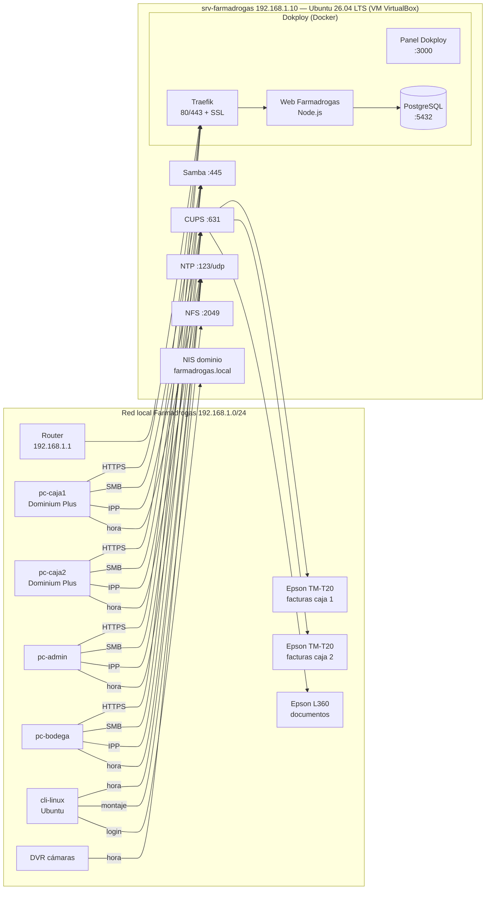

# Análisis y Diseño de Infraestructura — Droguería Farmadrogas

**Curso:** Administración de Infraestructura de TI — Universidad del Quindío
**Profesor:** Maycol Cárdenas Acevedo
**Entregable 1 (Semana 1):** Análisis de necesidades y diseño
**Estudiante:** Jefferson Rubio Rincón
**Fecha:** noviembre de 2026

---

## 1. Descripción de la empresa

| Dato | Valor |
|---|---|
| Nombre | Droguería Farmadrogas |
| Ubicación | Armenia, Quindío, Colombia |
| Sector | Comercio minorista de medicamentos y productos de cuidado personal |
| Tipo | Empresa familiar |
| Propietaria | Rocío |
| Personal | Alirio y Daniel (atención y caja); Jefferson Rubio (encargado de TI) |
| Empleados | 3 |
| Computadores | 4 (Windows) |
| Impresoras | 2 Epson TM-T20 (térmicas de tirilla, facturación en caja) y 1 Epson L360 (multifuncional de tinta continua, documentos y reportes) |
| Software de negocio | Dominium Plus (facturación, inventario y ventas) |
| Otros equipos | Sistema de cámaras de seguridad |

### Situación actual (problemas identificados)

1. **Archivos dispersos:** reportes, copias de seguridad de Dominium Plus, facturas de proveedores y documentos quedan guardados en cada PC por separado. Si un equipo se daña, la información se pierde.
2. **Usuarios no centralizados:** cada PC tiene sus propias cuentas; no hay control de quién accede a qué ni forma rápida de dar de baja a un empleado.
3. **Impresión desordenada:** cada impresora está conectada a un solo PC por USB; si ese PC está apagado, nadie más puede imprimir.
4. **Hora no sincronizada:** los relojes de los PCs y del grabador de cámaras pueden quedar desfasados, lo que afecta la hora de las facturas, los cierres de caja y las grabaciones de video como evidencia.
5. **Sin presencia web propia:** los clientes no tienen dónde consultar horarios, servicios o disponibilidad de productos.

### Objetivo de la propuesta

Centralizar en **un servidor local** (máquina virtual Ubuntu Server con Dokploy) los servicios de archivos, usuarios, impresión, hora, web y base de datos, sin reemplazar Dominium Plus, que sigue siendo el sistema de facturación.

---

## 2. Servicios propuestos y justificación

| # | Servicio | Necesidad de Farmadrogas que resuelve |
|---|---|---|
| 1 | **Dokploy + Traefik** | Plataforma para desplegar la web y la base de datos en contenedores, con proxy inverso y certificados SSL, administrable desde un panel web sin depender de un proveedor externo. |
| 2 | **Web (Nginx/Node.js vía Dokploy)** | Sitio institucional: quiénes somos, horarios, servicios (toma de presión, inyectología, domicilios), contacto por WhatsApp y un **catálogo de consulta de productos** para que el cliente vea si hay disponibilidad antes de ir. |
| 3 | **Base de datos PostgreSQL (vía Dokploy)** | Guarda el catálogo de productos, categorías y la información que muestra la web. Separada de Dominium Plus para no tocar el sistema de facturación. |
| 4 | **NTP** | Todos los PCs y el grabador de cámaras con la misma hora: facturas con hora correcta, cierres de caja coherentes y grabaciones válidas como evidencia. |
| 5 | **Samba** | Carpetas compartidas desde los PCs Windows de caja: `Reportes`, `Proveedores`, `Respaldos_Dominium`. Las copias de seguridad de Dominium Plus quedan en el servidor y no en un solo PC. |
| 6 | **NFS** | Carpeta compartida para el equipo de administración Linux (cliente de pruebas) y para respaldos del propio servidor; permite montar la carpeta de documentos como si fuera local. |
| 7 | **NIS** | Autenticación centralizada: un solo usuario por persona (`rocio`, `alirio`, `daniel`, `jefferson`) válido en los equipos Linux de la red. Al salir un empleado se desactiva en un solo lugar. |
| 8 | **CUPS** | Servidor de impresión: las 2 Epson TM-T20 (tirilla de facturas) y la Epson L360 (documentos) se publican en la red con colas separadas (`facturas-caja1`, `facturas-caja2`, `documentos`) para que cualquier PC pueda imprimir. |

> **Nota:** Dominium Plus no se migra ni se modifica. El servidor solo lo complementa (respaldos en Samba, hora por NTP, impresión por CUPS).

---

## 3. Topología y direccionamiento

**Red local:** `192.168.1.0/24` — puerta de enlace `192.168.1.1` (router del local)
**Máquina virtual:** VirtualBox, Ubuntu 26.04.1 LTS, 2 vCPU, 8 GB RAM (mínimo exigido: 4 GB), 40 GB disco, adaptador en **modo puente (bridged)**, IP estática.

| Equipo | Rol | IP | Sistema |
|---|---|---|---|
| `srv-farmadrogas` | Servidor (Dokploy + servicios Linux) | 192.168.1.10 | Ubuntu 26.04.1 LTS |
| `pc-caja1` | Caja 1 — Dominium Plus | 192.168.1.21 | Windows |
| `pc-caja2` | Caja 2 — Dominium Plus | 192.168.1.22 | Windows |
| `pc-admin` | Administración / inventario | 192.168.1.23 | Windows |
| `pc-bodega` | Recepción de pedidos | 192.168.1.24 | Windows |
| `cli-linux` | Cliente de pruebas NFS/NIS (VM) | 192.168.1.30 | Ubuntu Desktop |
| `dvr-camaras` | Grabador de cámaras | 192.168.1.40 | Firmware del fabricante |

> Las IPs son el plan de diseño; si la red de la práctica usa otro rango, se ajustan manteniendo el mismo último octeto.

### Nombres y dominio

- **Dominio NIS:** `farmadrogas.local`
- **Dominio web:** `farmadrogas.192.168.1.10.sslip.io` (DNS gratuito que resuelve automáticamente a la IP del servidor, sin configurar un DNS propio).
- **SSL/TLS:** certificado **autofirmado** gestionado por Traefik. Se justifica porque el servidor es local y no es accesible desde Internet, por lo que Let's Encrypt no puede validar el dominio. Si en el futuro se publica, se cambia a Let's Encrypt desde el panel de Dokploy.

---

## 4. Tabla de requisitos (IP, puerto, protocolo, servicio)

| Servicio | IP servidor | Puerto(s) | Protocolo | Tipo de servicio | Clientes |
|---|---|---|---|---|---|
| SSH (administración) | 192.168.1.10 | 22 | TCP | Acceso remoto | Administrador |
| Traefik HTTP | 192.168.1.10 | 80 | TCP | Proxy inverso (redirige a HTTPS) | Todos |
| Traefik HTTPS | 192.168.1.10 | 443 | TCP | Proxy inverso + SSL | Todos / clientes web |
| Panel Dokploy | 192.168.1.10 | 3000 | TCP | Plataforma PaaS (administración) | Administrador |
| Web Farmadrogas | (contenedor, vía Traefik) | 443 externo | HTTPS | Aplicación web (Node.js) | Clientes y empleados |
| PostgreSQL | (contenedor Dokploy) | 5432 (red interna) | TCP | Base de datos | Aplicación web |
| NTP | 192.168.1.10 | 123 | UDP | Sincronización horaria | PCs, cliente Linux, DVR |
| NFS | 192.168.1.10 | 2049 (+111 rpcbind) | TCP/UDP | Compartición de archivos Linux | `cli-linux` |
| NIS (ypserv / ypbind) | 192.168.1.10 | 111 (rpcbind) + puertos RPC | TCP/UDP | Autenticación centralizada | `cli-linux` |
| CUPS | 192.168.1.10 | 631 | TCP (IPP) | Servidor de impresión | Todos los PCs |
| Samba | 192.168.1.10 | 445, 139 / 137–138 | TCP / UDP | Compartición de archivos Windows | PCs Windows |

### Usuarios y grupos

| Usuario | Grupo(s) | Uso |
|---|---|---|
| `jefferson` | `farmadrogas`, `sambausers`, `lpadmin`, `sudo` | Encargado de TI: administración del servidor e impresoras |
| `rocio` | `farmadrogas`, `sambausers` | Propietaria: acceso a reportes y respaldos |
| `alirio` | `farmadrogas`, `sambausers` | Empleado (caja / atención) |
| `daniel` | `farmadrogas`, `sambausers` | Empleado (caja / atención) |

### Recursos compartidos

| Recurso | Ruta en servidor | Servicio | Permisos |
|---|---|---|---|
| `documentos` | `/srv/nfs/farmadrogas` | NFS | `rw` para `192.168.1.0/24` |
| `farmadrogas` | `/srv/samba/farmadrogas` (subcarpetas `Reportes`, `Proveedores`, `Respaldos_Dominium`) | Samba | Solo grupo `sambausers` |
| `facturas-caja1`, `facturas-caja2` | Colas CUPS (Epson TM-T20, driver ESC/POS / cola raw) | CUPS | Todos los PCs de la red |
| `documentos` | Cola CUPS (Epson L360, driver ESC/P-R) | CUPS | Todos los PCs de la red |

---

## 5. Diagrama de arquitectura

Archivo fuente: [`diagrama.mmd`](diagrama.mmd)

---

## 6. Plan de implementación

| Semana | Entregable | Contenido |
|---|---|---|
| 1 | Análisis y diseño | Este documento + `diagrama.mmd` |
| 2 | Infraestructura base | VM Ubuntu con IP fija, Dokploy instalado, NTP, dominio sslip.io y SSL |
| 3 | Servicios | Web + PostgreSQL en Dokploy, NFS, NIS, CUPS, Samba |
| 4 | Documentación y presentación | `documentacion.md` con capturas + demo en vivo (15 min) |

**Extras planeados (puntos adicionales):** firewall UFW con solo los puertos de la tabla abiertos, y respaldo automático diario (cron) de la carpeta Samba y de la base de datos.

---

## 7. Costo–beneficio (resumen preliminar)

| Concepto | Costo | Beneficio |
|---|---|---|
| Software (Ubuntu, Dokploy, Samba, CUPS, NFS, NIS, NTP, PostgreSQL) | $0 — todo es software libre | Sin licencias |
| Hardware | Se reutiliza un PC existente o un mini-PC (estimar al cotizar) | Un solo equipo centraliza todo |
| Dominio | $0 (sslip.io) | Acceso por nombre sin pagar dominio |
| Tiempo de administración | Lo asume el encargado de TI de la droguería (Jefferson) | Altas/bajas de usuarios e impresoras en un solo lugar |
| Riesgo evitado | — | Pérdida de respaldos de Dominium Plus, facturas con hora incorrecta, impresoras inaccesibles |
