# Documentación Técnica — Infraestructura de Servicios Droguería Farmadrogas

**Curso:** Administración de Infraestructura de TI — Universidad del Quindío
**Profesor:** Maycol Cárdenas Acevedo
**Estudiante:** Jefferson Rubio Rincón
**Empresa:** Droguería Farmadrogas — Armenia, Quindío

| Semana | Contenido | Estado |
|---|---|---|
| 1 | Análisis y diseño → [`analisis.md`](analisis.md), [`diagrama.mmd`](diagrama.mmd) | ✅ |
| 2 | Infraestructura base: VM, IP fija, NTP, Dokploy, DNS, SSL | ✅ |
| 3 | Servicios: Web + PostgreSQL, NFS, NIS, CUPS, Samba | ⏳ |
| 4 | Documentación final y presentación | ⏳ |

---

# Semana 2 — Infraestructura Base

## Resumen del entorno

| Elemento | Valor |
|---|---|
| Hipervisor | Oracle VirtualBox |
| Máquina virtual | `srv-farmadrogas` |
| Sistema operativo | Ubuntu 26.04.1 LTS (kernel 7.0) |
| Recursos | 2 vCPU, 8 GB RAM, 40 GB disco |
| Red | Adaptador puente, IP estática `192.168.1.10/24`, gateway `192.168.1.1` |
| Usuario administrador | `jeffer` |
| Zona horaria | America/Bogota (UTC−5) |
| Servidor de hora | NTPsec (puerto 123/UDP) |
| Plataforma PaaS | Dokploy + Traefik v3.6 (Docker Swarm) |
| Dominio | `farmadrogas.192.168.1.10.sslip.io` |
| SSL/TLS | Certificado autofirmado de Traefik, TLS 1.3 |

> **Nota sobre la versión:** el proyecto sugiere Ubuntu 22.04/24.04. Se usó **Ubuntu 26.04.1 LTS**, la versión LTS más reciente (soporte hasta 2031), compatible con todos los servicios requeridos. La VM se configuró con 8 GB de RAM (el mínimo es 4 GB) para que Dokploy y los servicios de la semana 3 corran con holgura.

---

## 1. Red del equipo anfitrión

Se identificó la red local para elegir una IP libre para el servidor: red `192.168.1.0/24`, puerta de enlace `192.168.1.1`.

```cmd
ipconfig
```

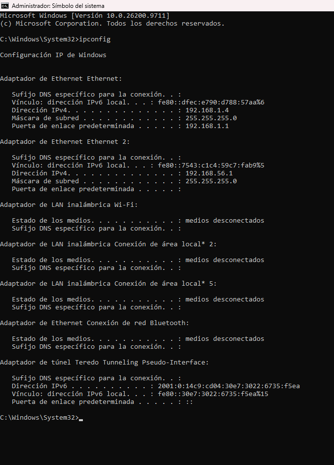

---

## 2. Creación de la máquina virtual

Se creó la VM `srv-farmadrogas` en VirtualBox con el adaptador de red en **modo puente**, para que el servidor quede en la misma red que los equipos de la droguería.

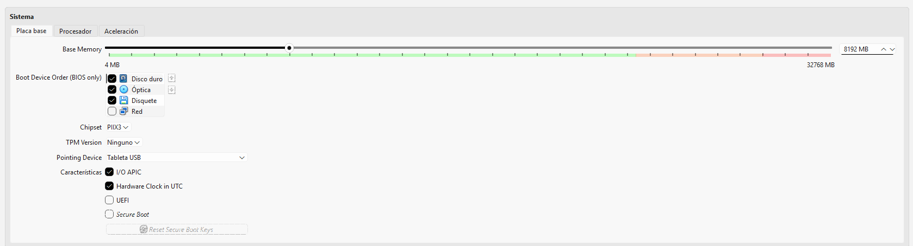

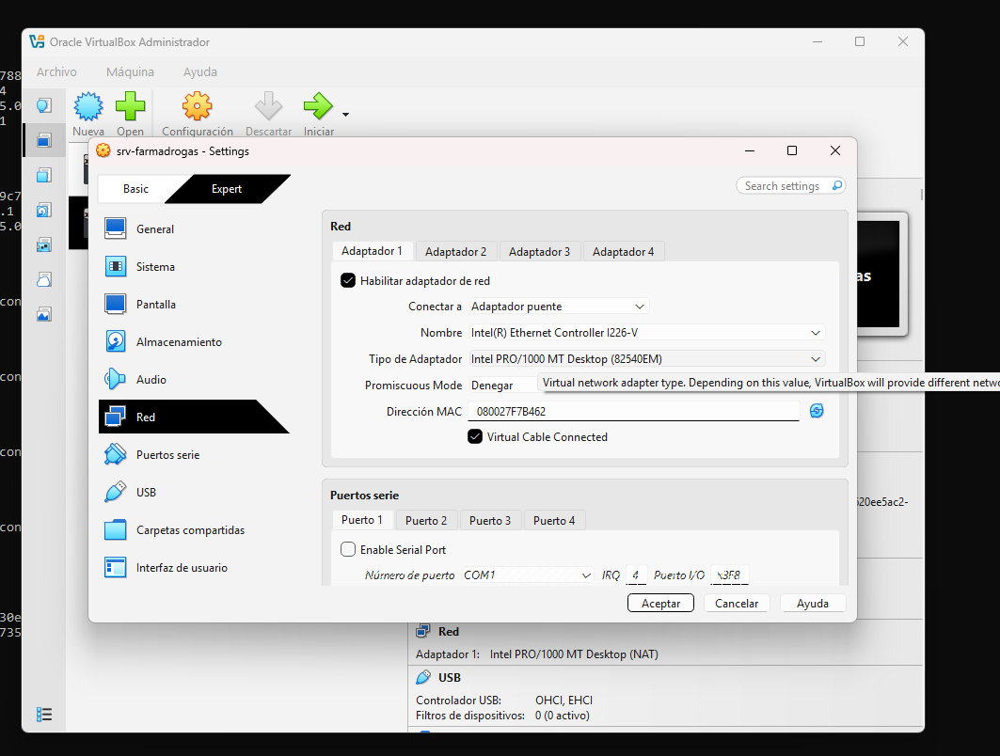

---

## 3. Instalación del sistema operativo

Se instaló Ubuntu 26.04.1 LTS con nombre de equipo `srv-farmadrogas`, usuario `jeffer` y servidor OpenSSH.

```bash
hostnamectl
lsb_release -a
```


---

## 4. IP estática

Se desactivó la configuración de red de cloud-init y se creó el archivo de Netplan con IP fija. Archivo completo: [`codigo/semana2/01-farmadrogas.yaml`](codigo/semana2/01-farmadrogas.yaml).

```bash
echo 'network: {config: disabled}' | sudo tee /etc/cloud/cloud.cfg.d/99-disable-network-config.cfg
sudo nano /etc/netplan/01-farmadrogas.yaml
```

```yaml
network:
  version: 2
  ethernets:
    enp0s3:
      dhcp4: false
      addresses:
        - 192.168.1.10/24
      routes:
        - to: default
          via: 192.168.1.1
      nameservers:
        addresses: [8.8.8.8, 1.1.1.1]
```

```bash
sudo chmod 600 /etc/netplan/01-farmadrogas.yaml
sudo netplan apply
ip -br a
ping -c 3 google.com
```

**Resultado:** `enp0s3` con `192.168.1.10/24` y salida a Internet (3 paquetes enviados, 3 recibidos, 0 % pérdida).

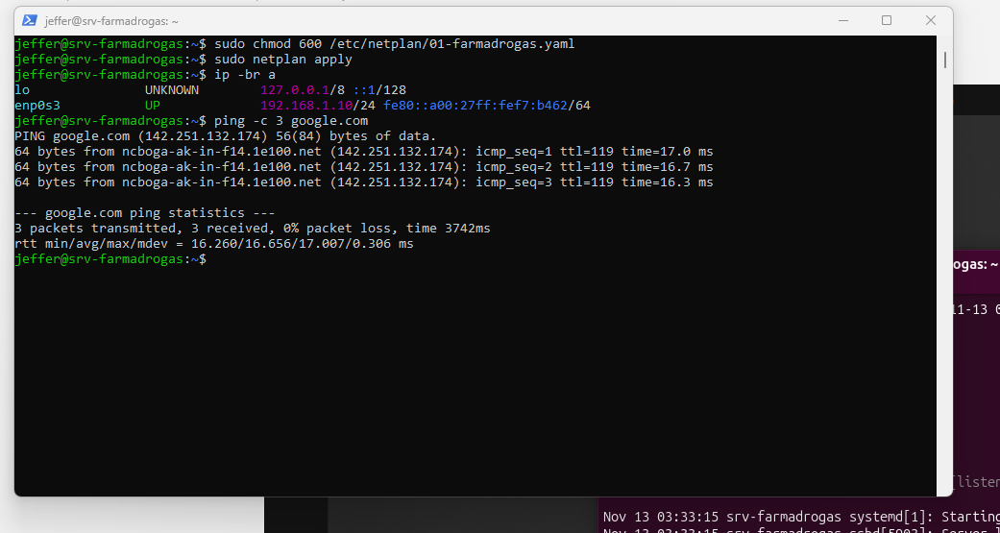

A partir de aquí la administración se hizo **por SSH** desde Windows (`ssh jeffer@192.168.1.10`), como se ve en las ventanas de terminal de las siguientes capturas.

---

## 5. Actualización y zona horaria

```bash
sudo apt update && sudo apt upgrade -y
sudo timedatectl set-timezone America/Bogota
timedatectl
```

**Resultado:** `Time zone: America/Bogota (-05, -0500)`, `System clock synchronized: yes`.

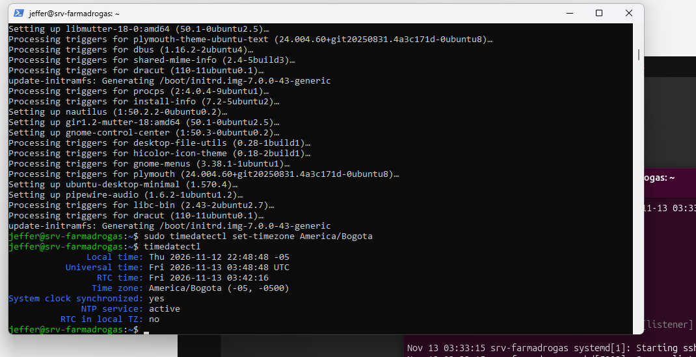

---

## 6. Servicio NTP (servidor de hora)

**Objetivo para Farmadrogas:** que los PCs de caja, el equipo de administración y el grabador de cámaras tengan la misma hora (facturas, cierres de caja y grabaciones con hora correcta).

En Ubuntu 26.04 el servidor NTP es **NTPsec** (sucesor del paquete `ntp`); al instalarlo reemplaza a `systemd-timesyncd`.

```bash
sudo apt install ntpsec -y
sudo cp /etc/ntpsec/ntp.conf /etc/ntpsec/ntp.conf.bak
sudo nano /etc/ntpsec/ntp.conf
```

Se comentaron las líneas `pool` originales y se agregó al final ([`codigo/semana2/ntp-farmadrogas.conf`](codigo/semana2/ntp-farmadrogas.conf)):

```conf
server 0.co.pool.ntp.org iburst
server 1.co.pool.ntp.org iburst
server 0.south-america.pool.ntp.org iburst
pool pool.ntp.org iburst

restrict 192.168.1.0 mask 255.255.255.0 nomodify notrap nopeer
```

```bash
sudo systemctl restart ntpsec
sudo systemctl enable ntpsec
systemctl status ntpsec --no-pager
```


### Verificación en el servidor

```bash
ntpq -p
sudo ss -ulpn | grep :123
```

**Resultado:** `ntpq -p` muestra la fuente `0.co.pool.ntp.org` marcada con `*` (sincronizado) y `ntpd` escucha en `192.168.1.10:123/UDP`.


### Verificación desde un cliente Windows

```cmd
w32tm /stripchart /computer:192.168.1.10 /samples:5 /dataonly
```

**Resultado:** el PC Windows consulta la hora al servidor de la droguería y recibe 5 muestras (diferencia ≈ −0,37 s, que es lo que el cliente se corregiría al sincronizar).

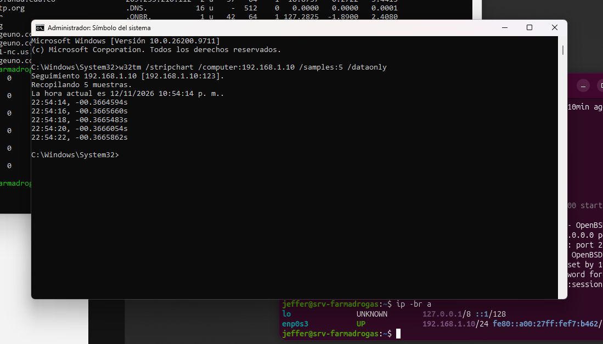

---

## 7. Instalación de Dokploy

```bash
sudo ss -tulpn | grep -E ':(80|443|3000)\s'   # verificar puertos libres
curl -sSL https://dokploy.com/install.sh | sudo sh
```

El instalador configuró Docker en modo Swarm, la red interna, Traefik y Dokploy, y terminó con *"Congratulations, Dokploy is installed!"*.

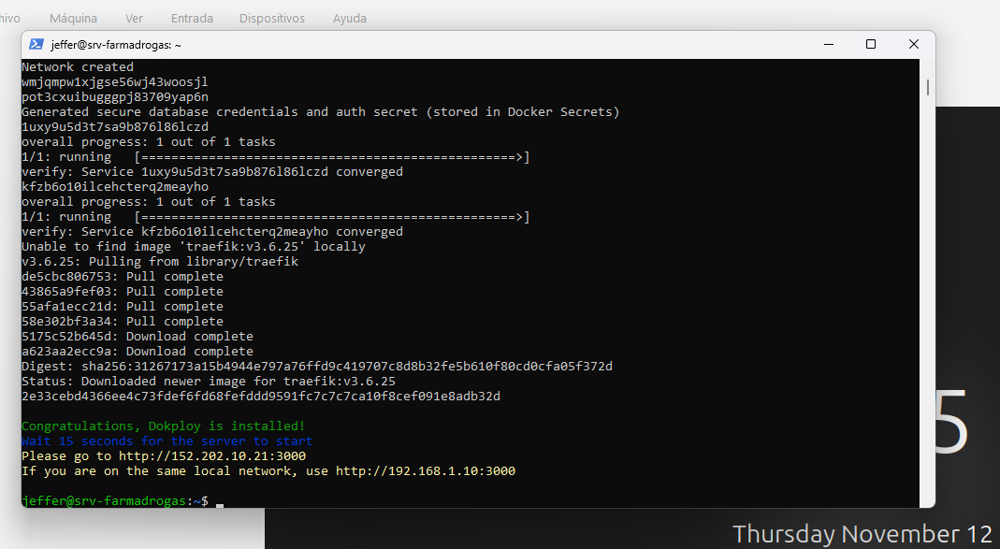

```bash
sudo docker ps
```


Se creó la cuenta de administrador en `http://192.168.1.10:3000`:

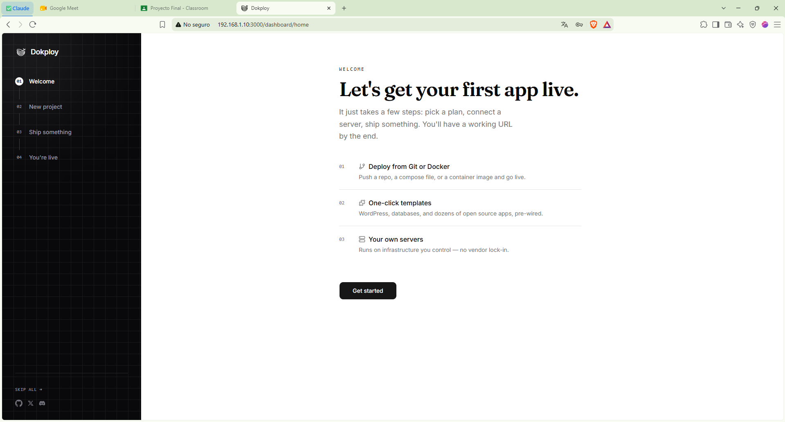

---

## 8. Dominio / DNS

Se usó **sslip.io**, un DNS gratuito en el que cualquier nombre que contiene una IP resuelve a esa IP, sin registrar dominio ni montar un servidor DNS propio.

**Dominio:** `farmadrogas.192.168.1.10.sslip.io`

```cmd
nslookup farmadrogas.192.168.1.10.sslip.io
```

**Resultado:** `Address: 192.168.1.10`.


---

## 9. Aplicación en Dokploy con HTTPS

Para la demostración de la semana 2 se desplegó una aplicación de prueba con Nginx. En la semana 3 se reemplaza por la web de Farmadrogas.

1. **Projects → Create Project:** `Farmadrogas`.
2. **Create Service → Application:** `web-prueba`.

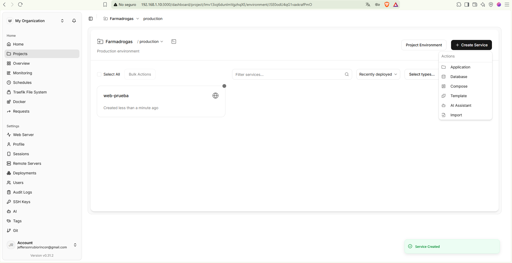

3. **Provider:** Docker, imagen `nginx:alpine` → **Deploy**.

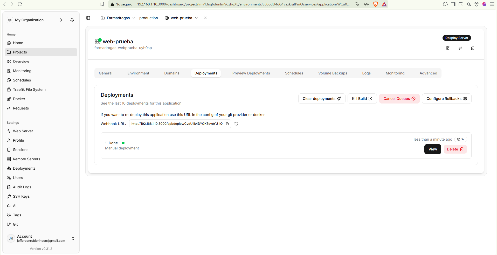

4. **Domains → Add Domain:** host `farmadrogas.192.168.1.10.sslip.io`, path `/`, puerto `80`, **HTTPS activado**, certificado `None` (Traefik genera uno autofirmado).

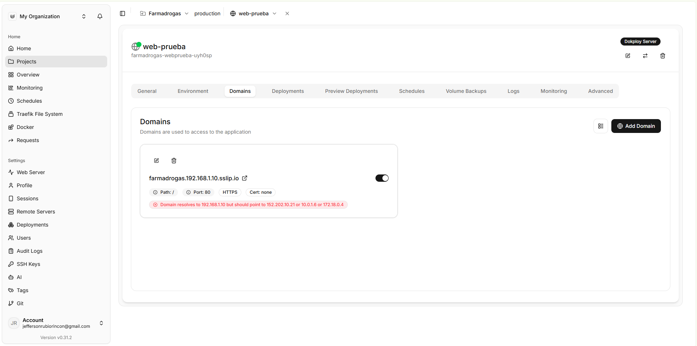

**¿Por qué certificado autofirmado?** Let's Encrypt necesita entrar desde Internet al servidor para validar el dominio. El servidor de Farmadrogas es **local** y no está expuesto a Internet, así que se usa un certificado autofirmado, que cifra igual el tráfico (opción permitida por el proyecto).

### Verificación

Sitio abierto por HTTPS en el navegador:

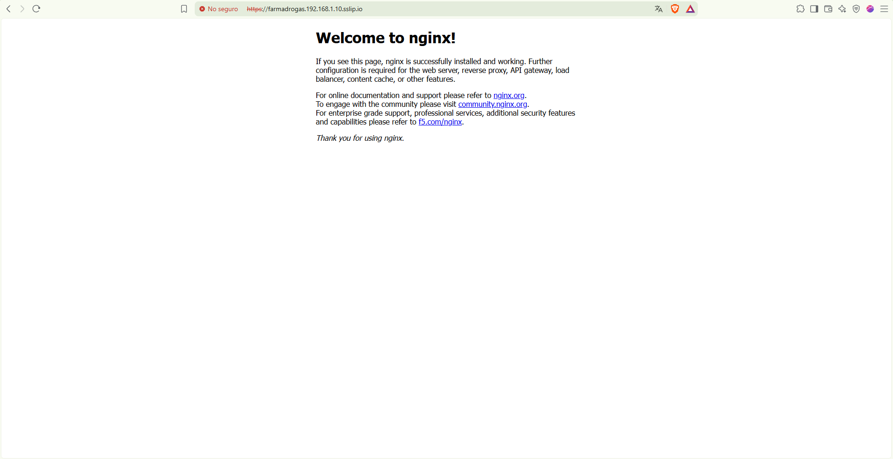

Detalles del certificado (`CN=TRAEFIK DEFAULT CERT`, válido del 12/11/2026 al 12/11/2027):

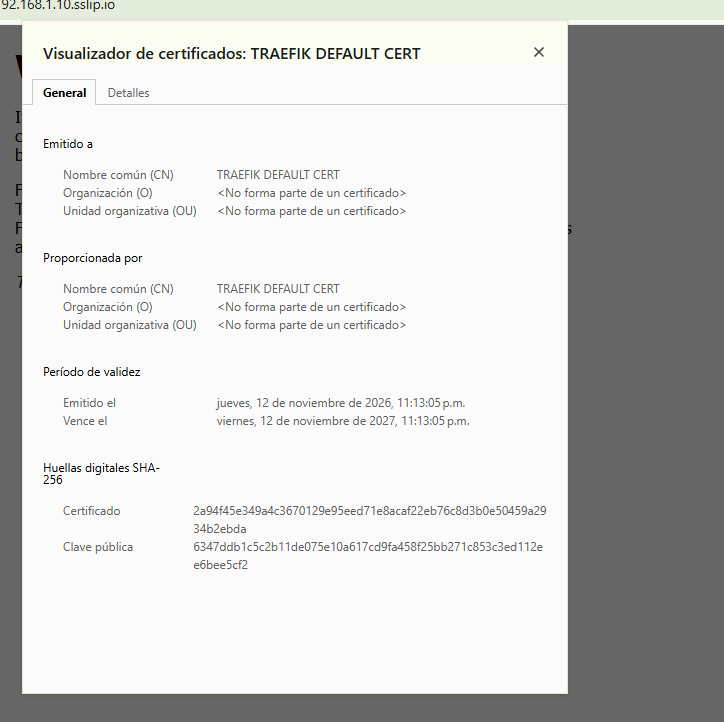

```bash
getent hosts farmadrogas.192.168.1.10.sslip.io
curl -I http://farmadrogas.192.168.1.10.sslip.io
curl -vkI https://farmadrogas.192.168.1.10.sslip.io 2>&1 | grep -E 'SSL connection|subject|issuer|HTTP/'
```

**Resultado:**
- HTTP responde `308 Permanent Redirect` hacia `https://` (redirección forzada a HTTPS).
- Conexión cifrada con **TLSv1.3** (`TLS_AES_128_GCM_SHA256`).
- Respuesta `HTTP/2 200`.


---

## 10. Instantánea de la VM

Se tomó la instantánea `semana2-base-ok` en VirtualBox como punto de restauración antes de la semana 3.

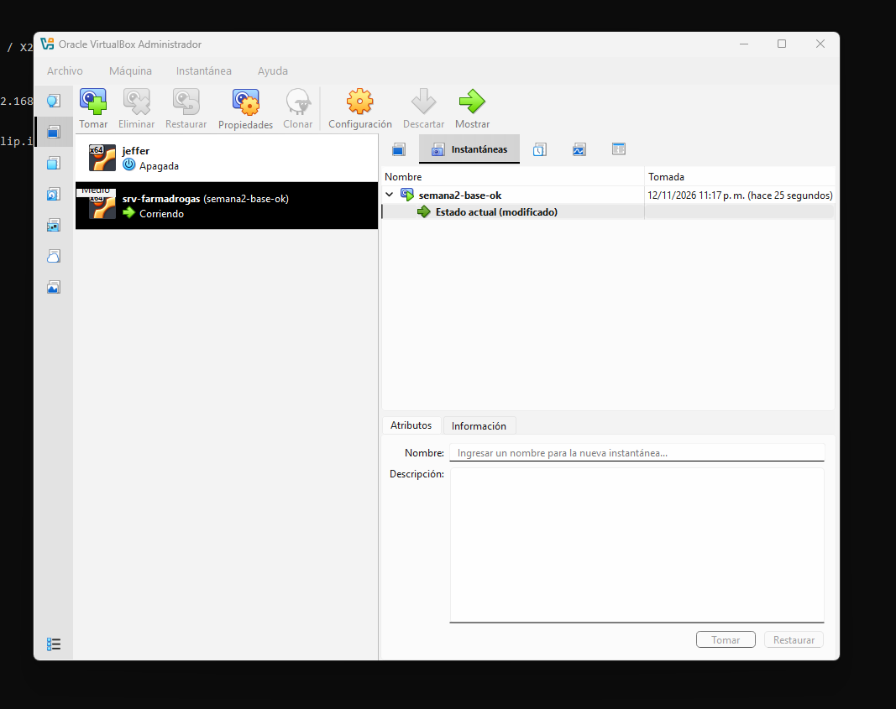

---

## 11. Verificación del Entregable 2

| Requisito | Evidencia | Estado |
|---|---|---|
| VM Ubuntu en VirtualBox, ≥ 2 vCPU, ≥ 4 GB RAM, 40 GB, modo puente | Capturas 2, 3, 4 | ✅ |
| IP estática | Captura 6 | ✅ |
| Servicio NTP configurado y sincronizado | Capturas 10, 11 | ✅ |
| Clientes obtienen la hora del servidor | Captura 12 | ✅ |
| Dokploy instalado y accesible | Capturas 13, 14, 15 | ✅ |
| Dominio/DNS configurado | Capturas 16, 22 | ✅ |
| SSL/TLS configurado | Capturas 19, 20, 21, 22 | ✅ |

## 12. Problemas encontrados y soluciones

| Problema | Causa | Solución |
|---|---|---|
| La VM funcionaba muy lento (ícono de tortuga en VirtualBox) | Windows tenía activo el hipervisor de Hyper-V (usado por WSL/Podman) y VirtualBox corría encima de él | Desactivar *Integridad de memoria* y ejecutar `bcdedit /set hypervisorlaunchtype off`, luego reiniciar. Se revierte con `bcdedit /set hypervisorlaunchtype auto` |
| No se puede copiar y pegar en la consola de la VM | La consola de VirtualBox no comparte el portapapeles en modo texto | Administrar el servidor por SSH desde Windows |
| SSH mostró `REMOTE HOST IDENTIFICATION HAS CHANGED` | Esa IP la había usado antes otra VM y Windows tenía guardada su huella | `ssh-keygen -R <IP>` y volver a conectar |
| Se perdió la conexión SSH al aplicar la IP fija | La IP del servidor cambió de la asignada por DHCP a `192.168.1.10` | Reconectar con `ssh jeffer@192.168.1.10` |
| Dokploy muestra *"Domain resolves to 192.168.1.10 but should point to 152.202.10.21…"* | Dokploy compara el DNS con la IP pública porque asume un servidor expuesto a Internet (para Let's Encrypt) | Es solo una advertencia: el servidor es local por diseño, Traefik enruta por nombre de host y el sitio funciona por HTTPS |
