# Documentación Técnica — Infraestructura de Servicios Droguería Farmadrogas

**Curso:** Administración de Infraestructura de TI — Universidad del Quindío
**Profesor:** Maycol Cárdenas Acevedo
**Estudiante:** Jefferson Rubio Rincón
**Empresa:** Droguería Farmadrogas — Armenia, Quindío

| Semana | Contenido | Estado |
|---|---|---|
| 1 | Análisis y diseño → [`analisis.md`](analisis.md), [`diagrama.mmd`](diagrama.mmd) | ✅ |
| 2 | Infraestructura base: VM, IP fija, NTP, Dokploy, DNS, SSL | ✅ |
| 3 | Servicios — Parte A: Web + PostgreSQL | ✅ |
| 3 | Servicios — Parte B: cliente Linux, NTP, NIS, NFS | ✅ |
| 3 | Servicios — Parte C: CUPS, Samba | ⏳ |
| 4 | Documentación final y presentación | ⏳ |

---

# Semana 2 — Infraestructura Base

## Resumen del entorno

| Elemento | Valor |
|---|---|
| Hipervisor | Oracle VirtualBox |
| Máquina virtual | `srv-farmadrogas` |
| Sistema operativo | Ubuntu 26.04.1 LTS (kernel 7.0) |
| Recursos | 2 vCPU, 8 GB RAM, 40 GB disco |
| Red | Adaptador puente, IP estática `192.168.1.10/24`, gateway `192.168.1.1` |
| Usuario administrador | `jeffer` |
| Zona horaria | America/Bogota (UTC−5) |
| Servidor de hora | NTPsec (puerto 123/UDP) |
| Plataforma PaaS | Dokploy + Traefik v3.6 (Docker Swarm) |
| Dominio | `farmadrogas.192.168.1.10.sslip.io` |
| SSL/TLS | Certificado autofirmado de Traefik, TLS 1.3 |

> **Nota sobre la versión:** el proyecto sugiere Ubuntu 22.04/24.04. Se usó **Ubuntu 26.04.1 LTS**, la versión LTS más reciente (soporte hasta 2031), compatible con todos los servicios requeridos. La VM se configuró con 8 GB de RAM (el mínimo es 4 GB) para que Dokploy y los servicios de la semana 3 corran con holgura.

---

## 1. Red del equipo anfitrión

Se identificó la red local para elegir una IP libre para el servidor: red `192.168.1.0/24`, puerta de enlace `192.168.1.1`.

```cmd
ipconfig
```


---

## 2. Creación de la máquina virtual

Se creó la VM `srv-farmadrogas` en VirtualBox con el adaptador de red en **modo puente**, para que el servidor quede en la misma red que los equipos de la droguería.


---

## 3. Instalación del sistema operativo

Se instaló Ubuntu 26.04.1 LTS con nombre de equipo `srv-farmadrogas`, usuario `jeffer` y servidor OpenSSH.

```bash
hostnamectl
lsb_release -a
```

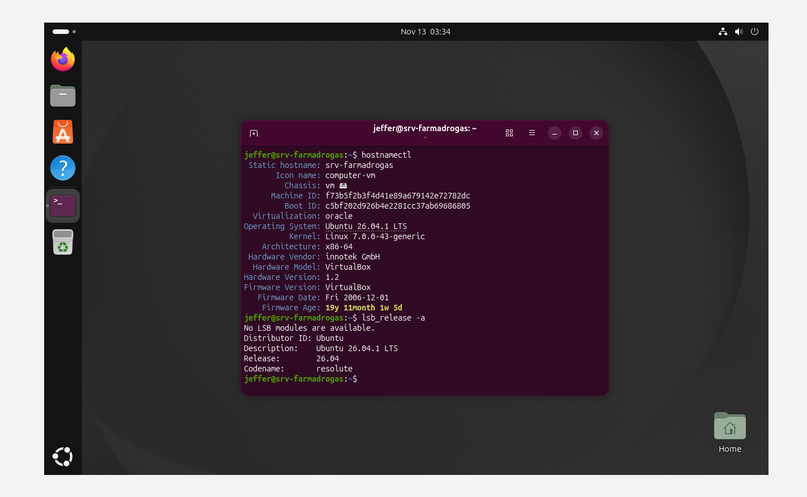

---

## 4. IP estática

Se desactivó la configuración de red de cloud-init y se creó el archivo de Netplan con IP fija. Archivo completo: [`codigo/semana2/01-farmadrogas.yaml`](codigo/semana2/01-farmadrogas.yaml).

```bash
echo 'network: {config: disabled}' | sudo tee /etc/cloud/cloud.cfg.d/99-disable-network-config.cfg
sudo nano /etc/netplan/01-farmadrogas.yaml
```

```yaml
network:
  version: 2
  ethernets:
    enp0s3:
      dhcp4: false
      addresses:
        - 192.168.1.10/24
      routes:
        - to: default
          via: 192.168.1.1
      nameservers:
        addresses: [8.8.8.8, 1.1.1.1]
```

```bash
sudo chmod 600 /etc/netplan/01-farmadrogas.yaml
sudo netplan apply
ip -br a
ping -c 3 google.com
```

**Resultado:** `enp0s3` con `192.168.1.10/24` y salida a Internet (3 paquetes enviados, 3 recibidos, 0 % pérdida).


A partir de aquí la administración se hizo **por SSH** desde Windows (`ssh jeffer@192.168.1.10`), como se ve en las ventanas de terminal de las siguientes capturas.

---

## 5. Actualización y zona horaria

```bash
sudo apt update && sudo apt upgrade -y
sudo timedatectl set-timezone America/Bogota
timedatectl
```

**Resultado:** `Time zone: America/Bogota (-05, -0500)`, `System clock synchronized: yes`.


---

## 6. Servicio NTP (servidor de hora)

**Objetivo para Farmadrogas:** que los PCs de caja, el equipo de administración y el grabador de cámaras tengan la misma hora (facturas, cierres de caja y grabaciones con hora correcta).

En Ubuntu 26.04 el servidor NTP es **NTPsec** (sucesor del paquete `ntp`); al instalarlo reemplaza a `systemd-timesyncd`.

```bash
sudo apt install ntpsec -y
sudo cp /etc/ntpsec/ntp.conf /etc/ntpsec/ntp.conf.bak
sudo nano /etc/ntpsec/ntp.conf
```

Se comentaron las líneas `pool` originales y se agregó al final ([`codigo/semana2/ntp-farmadrogas.conf`](codigo/semana2/ntp-farmadrogas.conf)):

```conf
server 0.co.pool.ntp.org iburst
server 1.co.pool.ntp.org iburst
server 0.south-america.pool.ntp.org iburst
pool pool.ntp.org iburst

restrict 192.168.1.0 mask 255.255.255.0 nomodify notrap nopeer
```

```bash
sudo systemctl restart ntpsec
sudo systemctl enable ntpsec
systemctl status ntpsec --no-pager
```

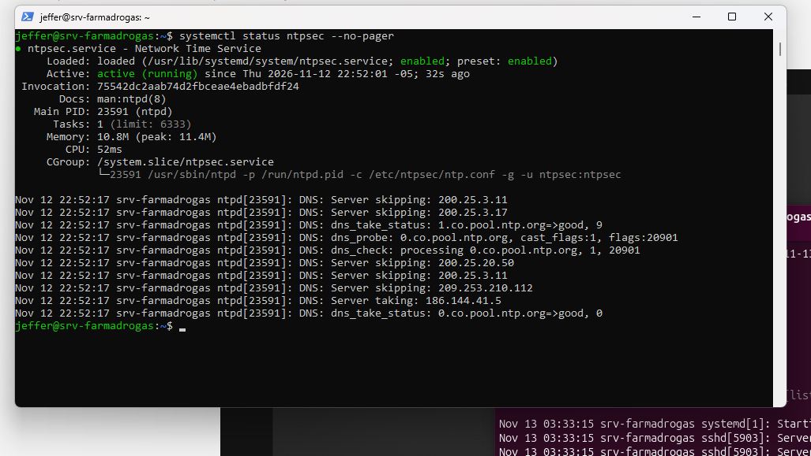

### Verificación en el servidor

```bash
ntpq -p
sudo ss -ulpn | grep :123
```

**Resultado:** `ntpq -p` muestra la fuente `0.co.pool.ntp.org` marcada con `*` (sincronizado) y `ntpd` escucha en `192.168.1.10:123/UDP`.

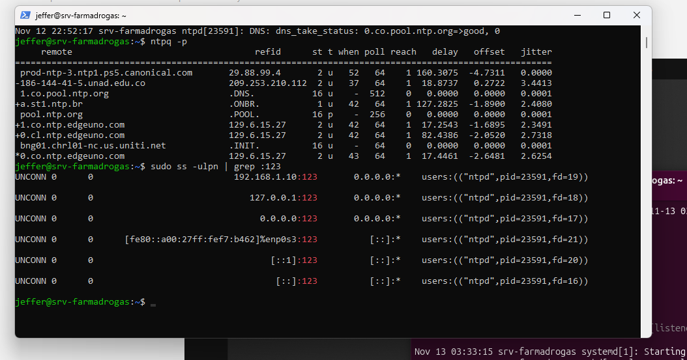

### Verificación desde un cliente Windows

```cmd
w32tm /stripchart /computer:192.168.1.10 /samples:5 /dataonly
```

**Resultado:** el PC Windows consulta la hora al servidor de la droguería y recibe 5 muestras (diferencia ≈ −0,37 s, que es lo que el cliente se corregiría al sincronizar).


---

## 7. Instalación de Dokploy

```bash
sudo ss -tulpn | grep -E ':(80|443|3000)\s'   # verificar puertos libres
curl -sSL https://dokploy.com/install.sh | sudo sh
```

El instalador configuró Docker en modo Swarm, la red interna, Traefik y Dokploy, y terminó con *"Congratulations, Dokploy is installed!"*.


```bash
sudo docker ps
```

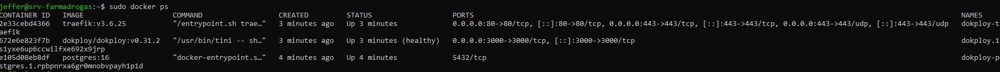

Se creó la cuenta de administrador en `http://192.168.1.10:3000`:


---

## 8. Dominio / DNS

Se usó **sslip.io**, un DNS gratuito en el que cualquier nombre que contiene una IP resuelve a esa IP, sin registrar dominio ni montar un servidor DNS propio.

**Dominio:** `farmadrogas.192.168.1.10.sslip.io`

```cmd
nslookup farmadrogas.192.168.1.10.sslip.io
```

**Resultado:** `Address: 192.168.1.10`.

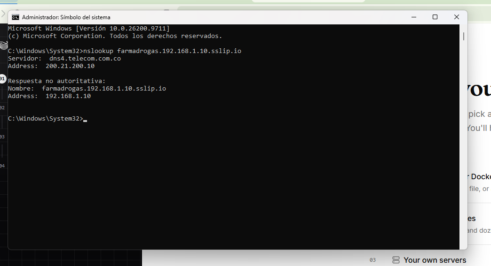

---

## 9. Aplicación en Dokploy con HTTPS

Para la demostración de la semana 2 se desplegó una aplicación de prueba con Nginx. En la semana 3 se reemplaza por la web de Farmadrogas.

1. **Projects → Create Project:** `Farmadrogas`.
2. **Create Service → Application:** `web-prueba`.


3. **Provider:** Docker, imagen `nginx:alpine` → **Deploy**.


4. **Domains → Add Domain:** host `farmadrogas.192.168.1.10.sslip.io`, path `/`, puerto `80`, **HTTPS activado**, certificado `None` (Traefik genera uno autofirmado).


**¿Por qué certificado autofirmado?** Let's Encrypt necesita entrar desde Internet al servidor para validar el dominio. El servidor de Farmadrogas es **local** y no está expuesto a Internet, así que se usa un certificado autofirmado, que cifra igual el tráfico (opción permitida por el proyecto).

### Verificación

Sitio abierto por HTTPS en el navegador:


Detalles del certificado (`CN=TRAEFIK DEFAULT CERT`, válido del 12/11/2026 al 12/11/2027):


```bash
getent hosts farmadrogas.192.168.1.10.sslip.io
curl -I http://farmadrogas.192.168.1.10.sslip.io
curl -vkI https://farmadrogas.192.168.1.10.sslip.io 2>&1 | grep -E 'SSL connection|subject|issuer|HTTP/'
```

**Resultado:**
- HTTP responde `308 Permanent Redirect` hacia `https://` (redirección forzada a HTTPS).
- Conexión cifrada con **TLSv1.3** (`TLS_AES_128_GCM_SHA256`).
- Respuesta `HTTP/2 200`.

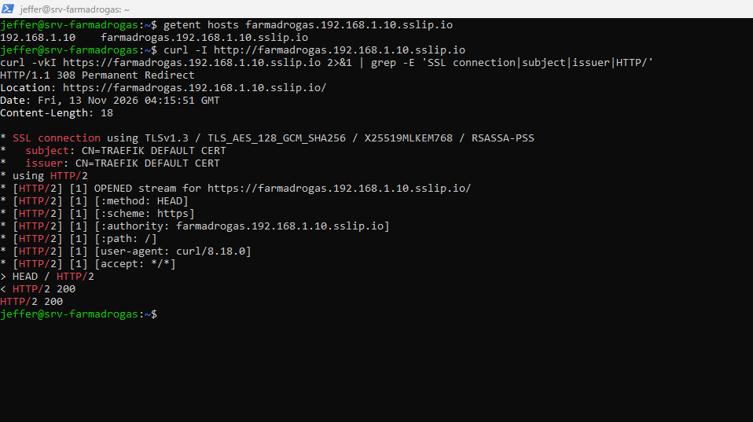

---

## 10. Instantánea de la VM

Se tomó la instantánea `semana2-base-ok` en VirtualBox como punto de restauración antes de la semana 3.


---

## 11. Verificación del Entregable 2

| Requisito | Evidencia | Estado |
|---|---|---|
| VM Ubuntu en VirtualBox, ≥ 2 vCPU, ≥ 4 GB RAM, 40 GB, modo puente | Capturas 2, 3, 4 | ✅ |
| IP estática | Captura 6 | ✅ |
| Servicio NTP configurado y sincronizado | Capturas 10, 11 | ✅ |
| Clientes obtienen la hora del servidor | Captura 12 | ✅ |
| Dokploy instalado y accesible | Capturas 13, 14, 15 | ✅ |
| Dominio/DNS configurado | Capturas 16, 22 | ✅ |
| SSL/TLS configurado | Capturas 19, 20, 21, 22 | ✅ |

## 12. Problemas encontrados y soluciones

| Problema | Causa | Solución |
|---|---|---|
| La VM funcionaba muy lento (ícono de tortuga en VirtualBox) | Windows tenía activo el hipervisor de Hyper-V (usado por WSL/Podman) y VirtualBox corría encima de él | Desactivar *Integridad de memoria* y ejecutar `bcdedit /set hypervisorlaunchtype off`, luego reiniciar. Se revierte con `bcdedit /set hypervisorlaunchtype auto` |
| No se puede copiar y pegar en la consola de la VM | La consola de VirtualBox no comparte el portapapeles en modo texto | Administrar el servidor por SSH desde Windows |
| SSH mostró `REMOTE HOST IDENTIFICATION HAS CHANGED` | Esa IP la había usado antes otra VM y Windows tenía guardada su huella | `ssh-keygen -R <IP>` y volver a conectar |
| Se perdió la conexión SSH al aplicar la IP fija | La IP del servidor cambió de la asignada por DHCP a `192.168.1.10` | Reconectar con `ssh jeffer@192.168.1.10` |
| Dokploy muestra *"Domain resolves to 192.168.1.10 but should point to 152.202.10.21…"* | Dokploy compara el DNS con la IP pública porque asume un servidor expuesto a Internet (para Let's Encrypt) | Es solo una advertencia: el servidor es local por diseño, Traefik enruta por nombre de host y el sitio funciona por HTTPS |

---

# Semana 3 — Parte A: Web de Farmadrogas + Base de datos PostgreSQL

## Arquitectura

```
Navegador ──HTTPS──► Traefik ──► web-farmadrogas (Node.js, puerto 3000) ──► farmadrogas-db (PostgreSQL)
                    (Dokploy)        código desde GitHub                         red interna de Docker
```

| Componente | Detalle |
|---|---|
| Aplicación | `web-farmadrogas` — Node.js 22 + Express, imagen construida con [`Dockerfile`](codigo/web-farmadrogas/Dockerfile) |
| Código | [`codigo/web-farmadrogas/`](codigo/web-farmadrogas/) en este repositorio |
| Base de datos | `farmadrogas-db` — PostgreSQL 18 creado desde Dokploy |
| Esquema | [`sql/init.sql`](codigo/web-farmadrogas/sql/init.sql): tablas `categorias`, `productos`, `mensajes` |
| Dominio | `https://farmadrogas.192.168.1.10.sslip.io` → contenedor puerto 3000 |

**Funciones de la web:** información de la droguería (servicios, horario, ubicación), **catálogo con buscador y filtro por categoría** leído desde PostgreSQL, formulario de contacto que guarda en la base de datos, panel `/admin.html` protegido con clave para agregar productos, y endpoint `/api/estado` que verifica la conexión con la base.

**Decisión de diseño:** el puerto 5432 de PostgreSQL **no se expone** a la red local. Solo la aplicación accede a la base por la red interna de Docker, así ningún equipo de la droguería puede conectarse directamente a ella.

---

## 1. Código en GitHub

El código de la web se subió a este repositorio; Dokploy lo descarga desde aquí para construir la imagen.

```powershell
git add .
git commit -m "Semana 3A: web de Farmadrogas con PostgreSQL"
git push
```

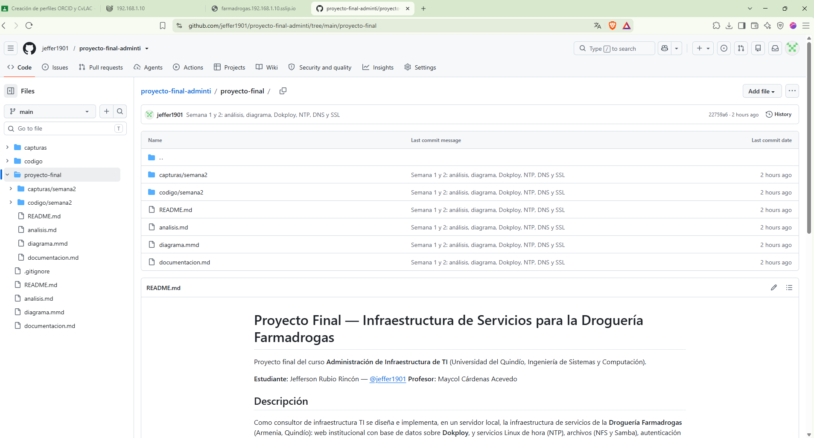

---

## 2. Base de datos PostgreSQL en Dokploy

Proyecto **Farmadrogas** → **Create Service** → **Database** → **PostgreSQL**:

| Campo | Valor |
|---|---|
| Name | `farmadrogas-db` |
| Database Name | `farmadrogas` |
| Database User | `farmadrogas` |
| Password | (definida por el administrador) |

Se desplegó con **Deploy** y se copió la **Internal Connection URL** de *Internal Credentials* para conectar la aplicación.

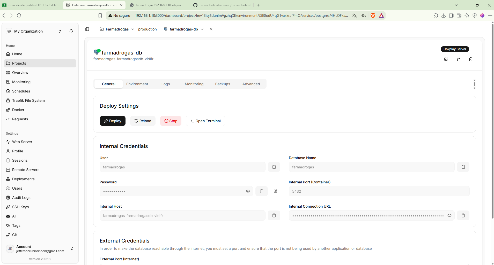

---

## 3. Aplicación web en Dokploy

1. Se quitó el dominio a la aplicación de prueba `web-prueba` (nginx) y se detuvo.
2. **Create Service → Application:** `web-farmadrogas`.
3. **Provider:** GitHub, repositorio `proyecto-final-adminti`, rama `main`, **Build Path** `/codigo/web-farmadrogas`, despliegue automático *On Push*. **Build Type:** Dockerfile.

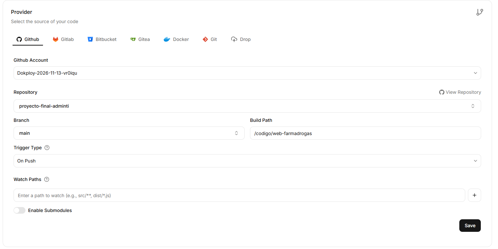

4. **Environment:**

```
DATABASE_URL=postgresql://farmadrogas:********@<host-interno-de-farmadrogas-db>:5432/farmadrogas
ADMIN_KEY=********
```

5. **Deploy.** Al arrancar, la aplicación crea las tablas y carga los productos iniciales:

```
Datos iniciales cargados: 16 productos
Web Farmadrogas escuchando en el puerto 3000
```

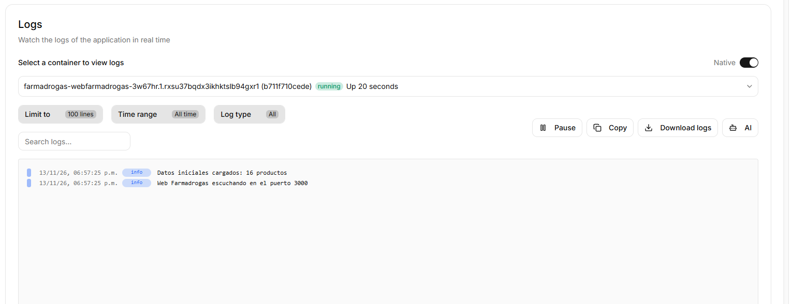

---

## 4. Dominio con HTTPS

**Domains → Add Domain:** host `farmadrogas.192.168.1.10.sslip.io`, path `/`, **container port 3000**, HTTPS activado, certificado autofirmado (*None*).

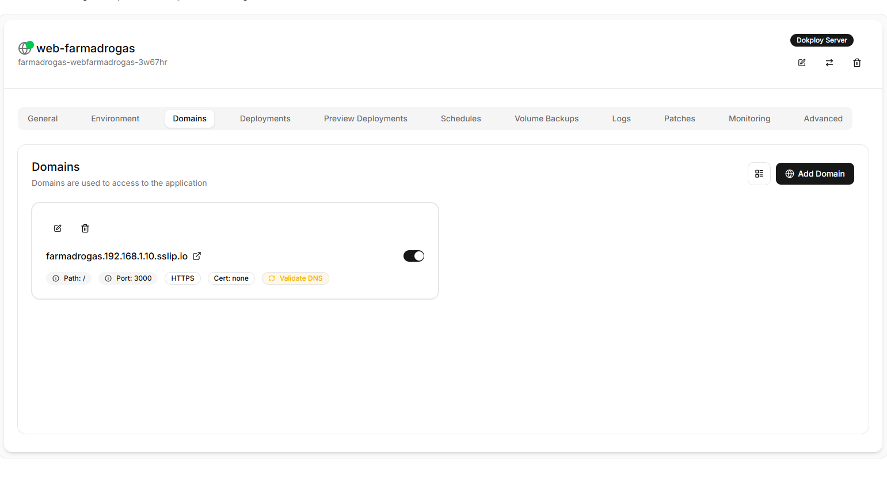

---

## 5. Pruebas

### 5.1 Sitio accesible por HTTPS

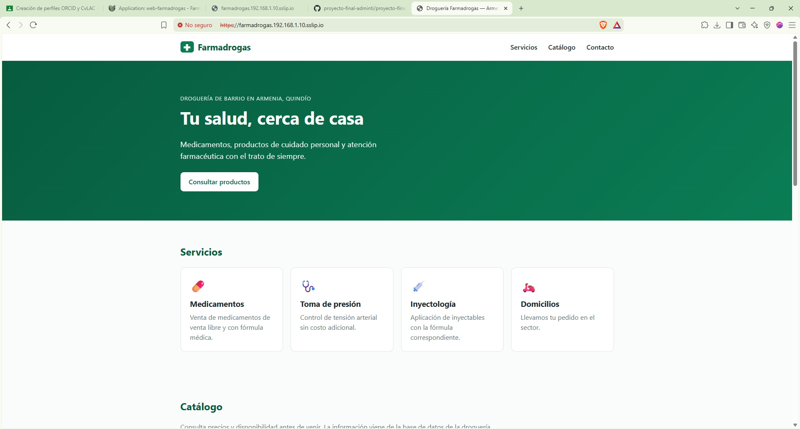

### 5.2 Catálogo leído desde PostgreSQL

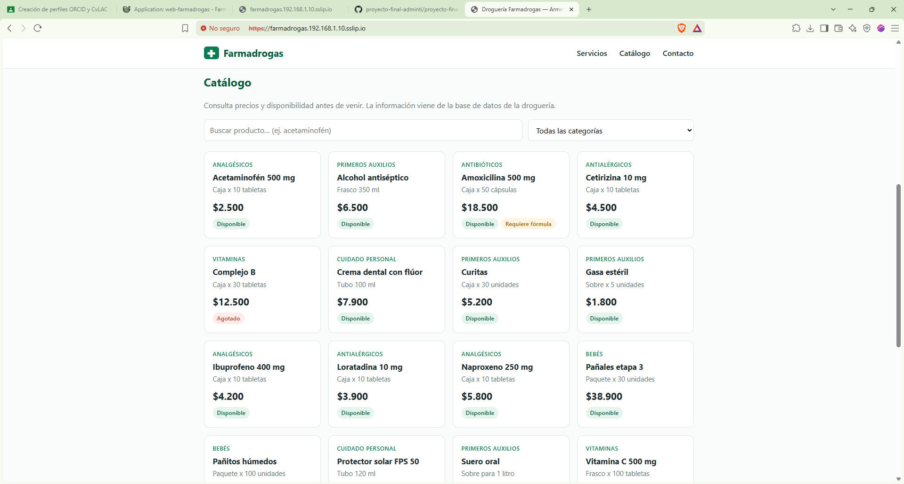

### 5.3 Escritura en la base de datos desde la web

Desde `/admin.html` se agregó el producto **Diclofenaco 50 mg**; la base le asignó el **id 17**.

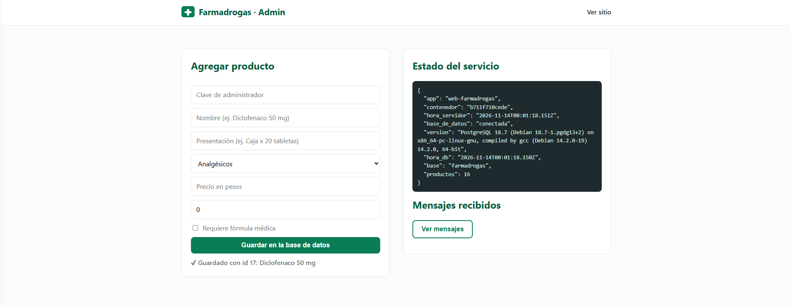

El producto nuevo aparece de inmediato en el buscador del catálogo:

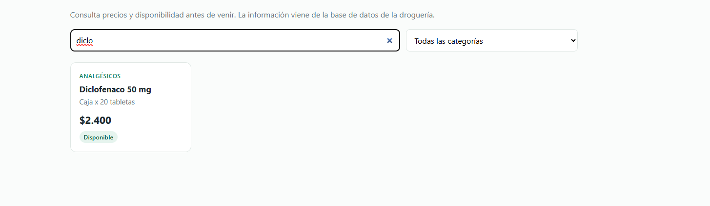

### 5.4 Estado de la conexión (`/api/estado`)

Responde `"base_de_datos": "conectada"`, la versión de PostgreSQL, el nombre de la base y `"productos": 17`.

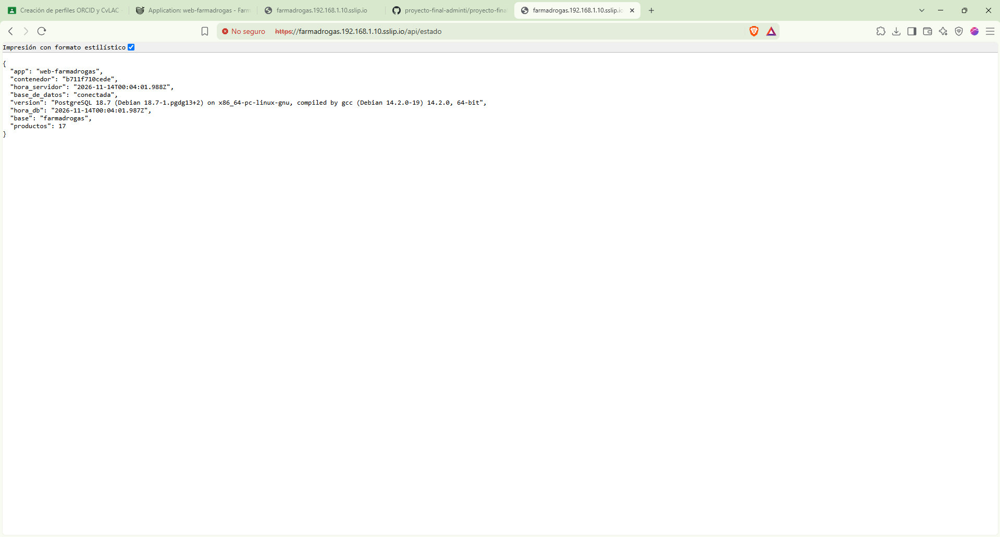

### 5.5 Verificación directa en PostgreSQL

Desde el servidor, entrando al contenedor de la base:

```bash
DB=$(sudo docker ps --format "{{.Names}} {{.Image}}" | grep -i postgres | grep -v '^dokploy-postgres' | awk '{print $1}' | head -n1)
sudo docker exec -it $DB psql -U farmadrogas -d farmadrogas -c "\dt"
sudo docker exec -it $DB psql -U farmadrogas -d farmadrogas -c "SELECT id, nombre, precio, stock FROM productos ORDER BY id DESC LIMIT 5;"
sudo docker exec -it $DB psql -U farmadrogas -d farmadrogas -c "SELECT nombre, mensaje, creado_en FROM mensajes;"
```

**Resultado:** existen las 3 tablas (`categorias`, `mensajes`, `productos`) con dueño `farmadrogas`, y el último registro de `productos` es el **Diclofenaco 50 mg (id 17)** creado desde la web, lo que confirma que la aplicación escribe en la base de datos.

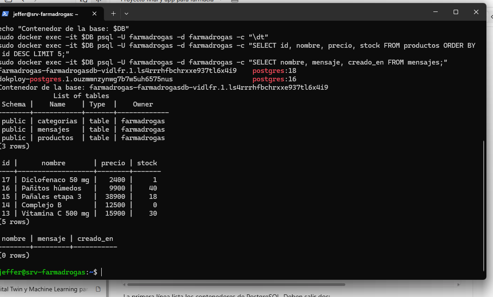

### 5.6 Servicios del proyecto en Dokploy

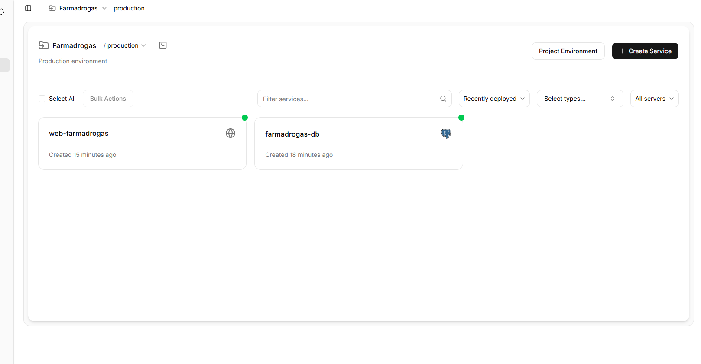

---

## 6. Verificación (Parte A)

| Requisito | Evidencia | Estado |
|---|---|---|
| App desplegada en Dokploy desde Git | S3A-04, S3A-06 | ✅ |
| Sitio accesible por HTTPS con contenido de la empresa | S3A-09, S3A-10 | ✅ |
| Base de datos PostgreSQL creada vía Dokploy | S3A-02 | ✅ |
| Base de datos conectada a la app (lectura y escritura) | S3A-10 a S3A-14 | ✅ |

## 7. Problemas encontrados y soluciones

| Problema | Causa | Solución |
|---|---|---|
| `git push` rechazado (*fetch first*) | El repositorio en GitHub ya tenía contenido que no estaba en el equipo local | `git pull origin main --allow-unrelated-histories --no-rebase -X ours` y luego `git push` |
| `docker exec` respondía *No such container* | Dokploy nombra el contenedor de la base con un prefijo y un sufijo aleatorio, así que el filtro `name=farmadrogas-db` no lo encontraba | Buscar el contenedor por imagen `postgres`, excluyendo la base interna de Dokploy |
| Dokploy muestra la advertencia de dominio de la semana 2 | El dominio apunta a la IP local, no a la IP pública | Advertencia esperada en un servidor local; el sitio funciona por HTTPS |

---

# Semana 3 — Parte B: Cliente Linux, NTP, NIS y NFS

## Arquitectura

```
        srv-farmadrogas 192.168.1.10                       cli-linux 192.168.1.30
 ┌──────────────────────────────────────┐           ┌───────────────────────────────┐
 │ NTP (ntpsec)          :123/udp  ─────┼── hora ──►│ chrony (cliente de hora)      │
 │ NIS ypserv  dominio farmadrogas.local┼── login ─►│ ypbind  (rocio, alirio,       │
 │   usuarios: rocio, alirio, daniel    │           │          daniel)              │
 │ NFS  /srv/nfs/farmadrogas ───────────┼── montaje►│ /mnt/farmadrogas  (documentos)│
 │      /srv/nfs/home       ────────────┼── montaje►│ /srv/nfs/home     (homes)     │
 └──────────────────────────────────────┘           └───────────────────────────────┘
```

**Diseño:** NIS centraliza las cuentas de la droguería; NFS comparte los documentos (solo para el grupo `farmadrogas`) y las carpetas personales, que siguen al usuario a cualquier equipo. Como NIS entrega los mismos UID/GID en todos los equipos, los permisos de NFS coinciden en servidor y cliente.

| Usuario | UID | Grupos | Rol |
|---|---|---|---|
| `rocio` | 1001 | `rocio`, `farmadrogas` (2000) | Propietaria |
| `alirio` | 1002 | `alirio`, `farmadrogas` (2000) | Caja |
| `daniel` | 1003 | `daniel`, `farmadrogas` (2000) | Caja |

Archivos de configuración: [`codigo/semana3/`](codigo/semana3/).

---

## 1. Equipo cliente `cli-linux`

VM en VirtualBox con Ubuntu 26.04.1 LTS (2 vCPU, 4 GB RAM, 25 GB, adaptador puente), usuario local `cliente`, OpenSSH e IP fija configurada con NetworkManager:

```bash
CON=$(nmcli -g NAME,DEVICE con show --active | grep ':enp0s3$' | cut -d: -f1)
sudo nmcli con mod "$CON" ipv4.method manual ipv4.addresses 192.168.1.30/24 ipv4.gateway 192.168.1.1 ipv4.dns "8.8.8.8 1.1.1.1"
sudo nmcli con up "$CON"
```

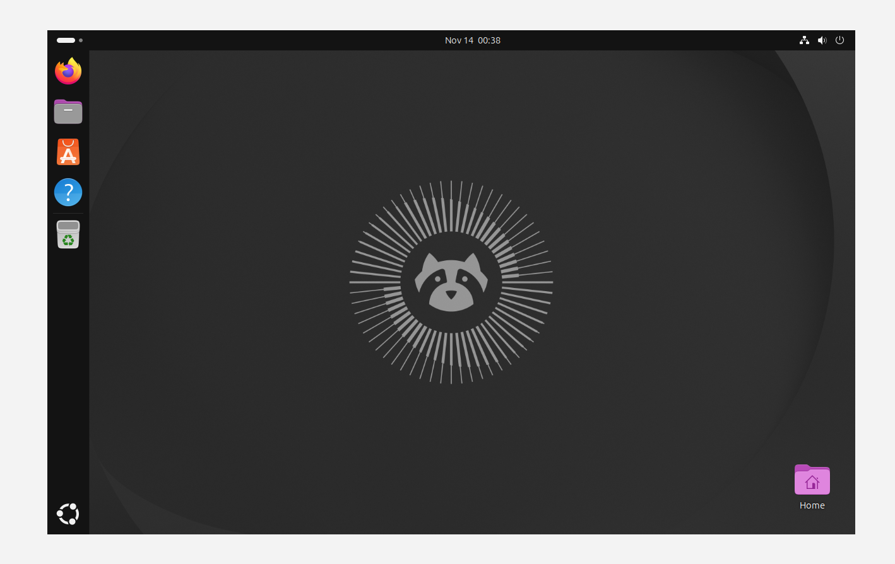

Resolución de nombres entre los dos equipos (`/etc/hosts` en ambos):

```
192.168.1.10  srv-farmadrogas srv-farmadrogas.farmadrogas.local
192.168.1.30  cli-linux
```

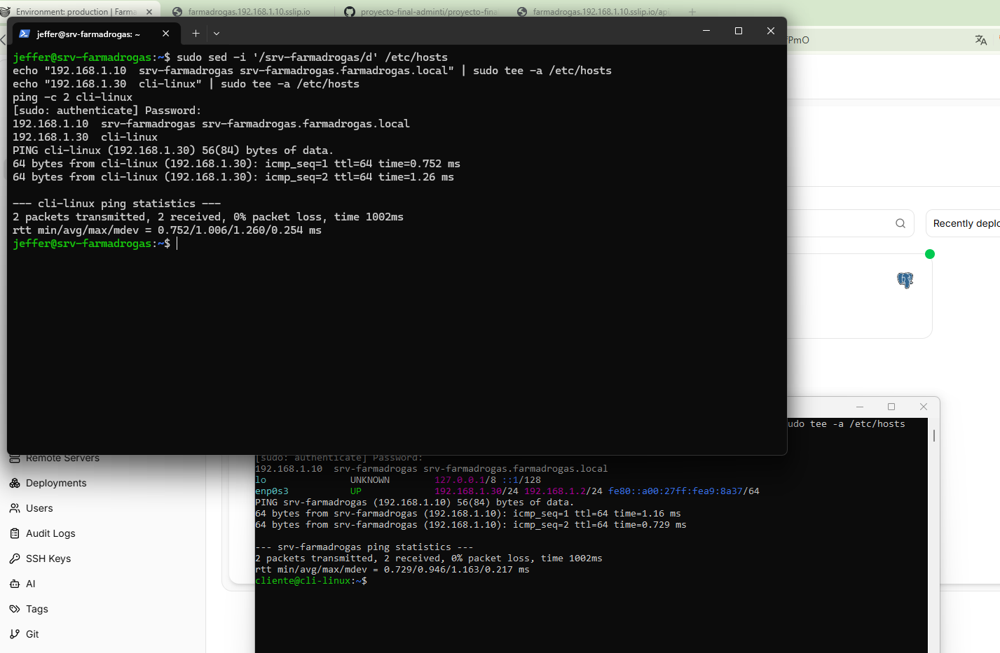

---

## 2. NTP: el cliente se sincroniza con el servidor de la droguería

Ubuntu 26.04 usa **chrony** como cliente de hora y trae servidores NTP de internet por defecto. Se comentaron esas fuentes y se dejó **solo** el servidor de Farmadrogas:

```bash
sudo timedatectl set-timezone America/Bogota
sudo sed -i -E 's/^\s*(pool|server|peer)\b/#&/' /etc/chrony/chrony.conf
echo "server 192.168.1.10 iburst prefer" | sudo tee -a /etc/chrony/chrony.conf
sudo systemctl restart chrony
chronyc sources -v
chronyc tracking
```

**Resultado:** única fuente `^* srv-farmadrogas` (sincronizado), `Reference ID : C0A8010A (srv-farmadrogas)` (= 192.168.1.10 en hexadecimal), stratum 4 (un nivel por debajo del servidor) y desfase de ~0,0001 s.

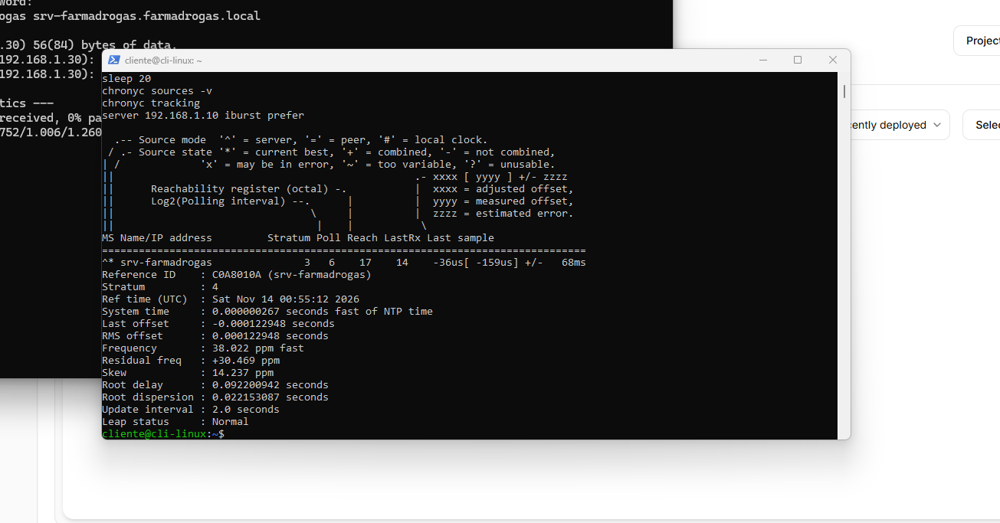

---

## 3. NIS: servidor de cuentas centralizadas

### 3.1 Instalación y dominio

```bash
sudo apt install -y nis
echo "farmadrogas.local" | sudo tee /etc/defaultdomain
sudo domainname farmadrogas.local
```

`/etc/ypserv.securenets` — solo localhost y la red de la droguería pueden consultar NIS:

```
255.0.0.0       127.0.0.0
255.255.255.0   192.168.1.0
```

### 3.2 Grupo y usuarios

Script completo: [`codigo/semana3/servidor-usuarios.sh`](codigo/semana3/servidor-usuarios.sh).

```bash
sudo groupadd -g 2000 farmadrogas
sudo mkdir -p /srv/nfs/home
for u in rocio alirio daniel; do
  sudo useradd -m -d /srv/nfs/home/$u -s /bin/bash -G farmadrogas $u
  echo "$u:Farma2026" | sudo chpasswd
done
```

### 3.3 Servidor maestro

```bash
sudo systemctl enable --now rpcbind ypserv
sudo /usr/lib/yp/ypinit -m
sudo systemctl enable --now yppasswdd
```

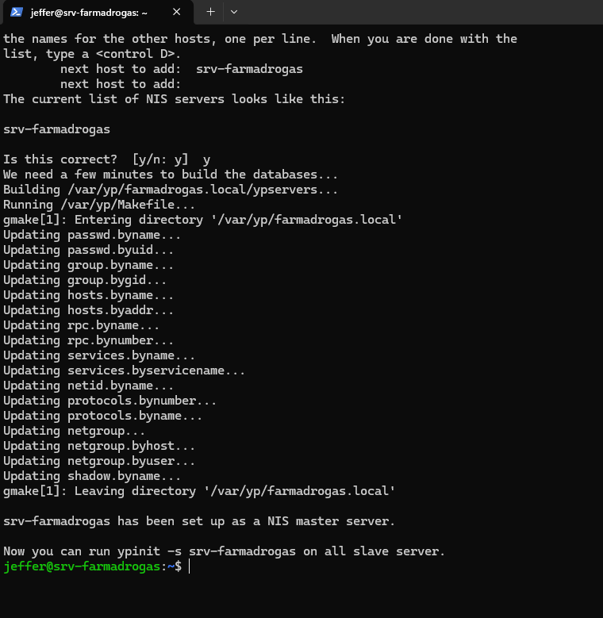

```bash
rpcinfo -p localhost | grep -E 'ypserv|yppasswdd|portmapper'
sudo ypcat -d farmadrogas.local -h localhost passwd | grep -E 'rocio|alirio|daniel'
```

**Resultado:** `ypserv` y `yppasswdd` registrados en RPC; el mapa `passwd` contiene los tres usuarios.

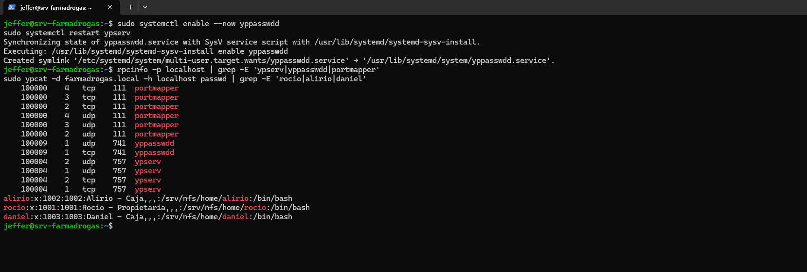

---

## 4. NFS: carpetas compartidas

```bash
sudo apt install -y nfs-kernel-server
sudo mkdir -p /srv/nfs/farmadrogas/{Reportes,Proveedores,Respaldos}
sudo chown -R root:farmadrogas /srv/nfs/farmadrogas
sudo chmod -R 2770 /srv/nfs/farmadrogas
```

**Permisos `2770`:** dueño y grupo `farmadrogas` leen y escriben; el resto **no tiene acceso**. El bit setgid (`2`) hace que todo archivo nuevo pertenezca al grupo `farmadrogas`, así todos los empleados pueden abrirlo.

`/etc/exports`:

```
/srv/nfs/farmadrogas  192.168.1.0/24(rw,sync,no_subtree_check,root_squash)
/srv/nfs/home         192.168.1.0/24(rw,sync,no_subtree_check,root_squash)
```

**¿Por qué `root_squash`?** La guía del curso usa `no_root_squash`; aquí se eligió `root_squash` para que el root de un equipo cliente se convierta en `nobody` en las carpetas compartidas. Así, un usuario con permisos de administrador en un PC de la droguería no puede leer ni borrar todo lo del servidor.

```bash
sudo exportfs -ra
sudo systemctl enable --now nfs-kernel-server
sudo exportfs -v
```

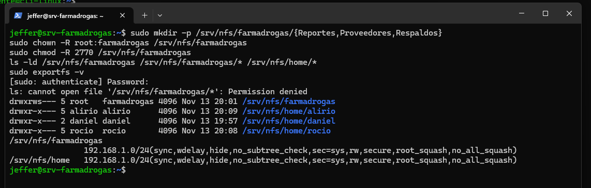

(El `Permission denied` del `ls` en esta captura es esperado: el administrador `jeffer` no pertenece al grupo `farmadrogas`.)

---

## 5. Configuración del cliente

Detalle completo: [`codigo/semana3/cliente-config.txt`](codigo/semana3/cliente-config.txt).

### 5.1 Unirse al dominio NIS

```bash
sudo apt install -y nis nfs-common
sudo systemctl disable --now ypserv
echo "farmadrogas.local" | sudo tee /etc/defaultdomain
echo "domain farmadrogas.local server 192.168.1.10" | sudo tee /etc/yp.conf
sudo systemctl enable --now rpcbind ypbind
```

En `/etc/nsswitch.conf` se agregó `nis` a `passwd`, `group`, `shadow` y `hosts`. Además, como `systemd-logind` tiene la red bloqueada por defecto, se le permitió consultar la red de la droguería:

```ini
# /etc/systemd/system/systemd-logind.service.d/nis.conf
[Service]
IPAddressAllow=192.168.1.0/24
```

```bash
ypwhich
ypcat passwd | grep -E 'rocio|alirio|daniel'
getent passwd rocio
id alirio
```

**Resultado:** el cliente está enlazado a `192.168.1.10` y reconoce a los tres usuarios, aunque **no existen localmente** en el cliente.

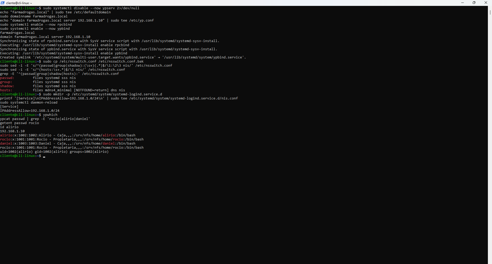

### 5.2 Montajes NFS persistentes

`/etc/fstab`:

```
192.168.1.10:/srv/nfs/farmadrogas  /mnt/farmadrogas  nfs  defaults,_netdev  0  0
192.168.1.10:/srv/nfs/home         /srv/nfs/home     nfs  defaults,_netdev  0  0
```

```bash
sudo mkdir -p /mnt/farmadrogas /srv/nfs/home
sudo mount -a
showmount -e 192.168.1.10
df -hT | grep nfs
```

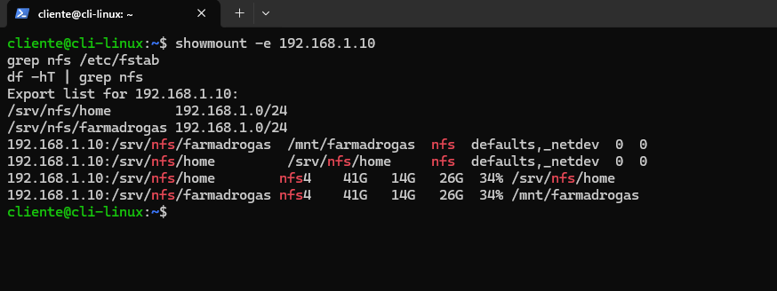

---

## 6. Pruebas: NIS + NFS trabajando juntos

### 6.1 Autenticación centralizada: Rocío inicia sesión en el cliente

```powershell
ssh rocio@192.168.1.30
```

La cuenta `rocio` solo existe en el servidor, pero inicia sesión en `cli-linux` con su contraseña. Su `id` muestra el grupo `farmadrogas` (2000) y crea el inventario en la carpeta compartida:

```bash
id
echo "Inventario de noviembre" > /mnt/farmadrogas/Reportes/inventario-nov.txt
ls -l /mnt/farmadrogas/Reportes/
```

**Resultado:** el archivo queda con dueño `rocio` y grupo `farmadrogas` (por el setgid).

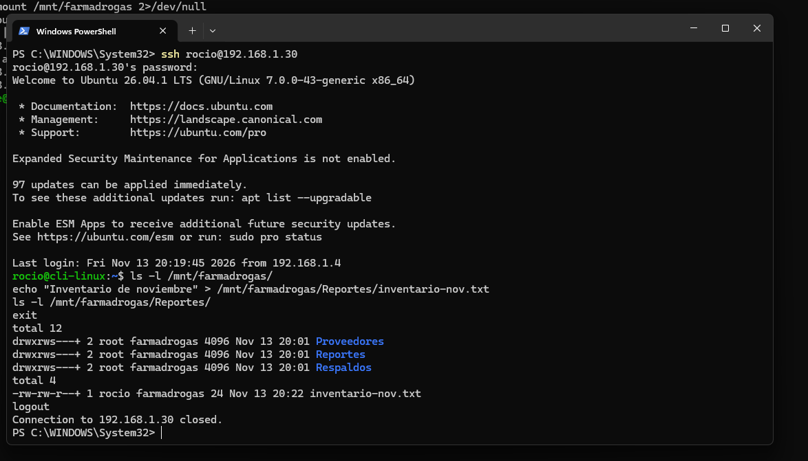

### 6.2 Permisos de grupo: Alirio edita el inventario, pero no ve lo privado

```bash
cat /mnt/farmadrogas/Reportes/inventario-nov.txt
echo "Revisado por Alirio" >> /mnt/farmadrogas/Reportes/inventario-nov.txt
cat ~rocio/notas.txt
```

**Resultado:** Alirio (grupo `farmadrogas`) lee y modifica el inventario; las notas personales de Rocío le responden **Permission denied**.

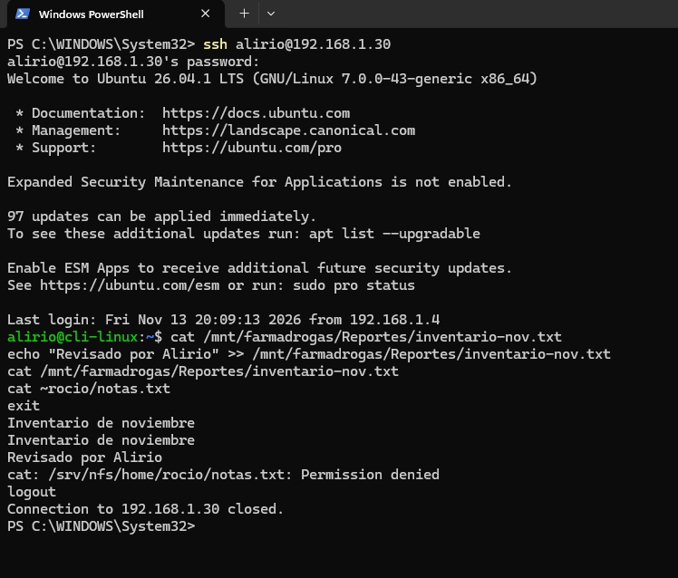

### 6.3 Sin acceso para quien no es de la droguería

```bash
ls /mnt/farmadrogas        # usuario local "cliente" (no pertenece al grupo)
sudo ls /mnt/farmadrogas   # root del cliente (root_squash → nobody)
```

**Resultado:** ambos reciben **Permission denied**. En el servidor, el administrador `jeffer` tampoco puede entrar sin `sudo`, porque no es del grupo.

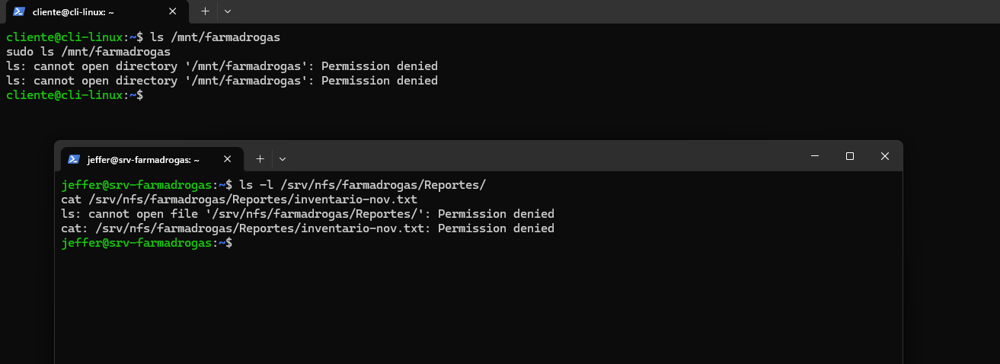

### 6.4 El archivo vive en el servidor

```bash
sudo ls -l /srv/nfs/farmadrogas/Reportes/
sudo cat /srv/nfs/farmadrogas/Reportes/inventario-nov.txt
```

**Resultado:** `inventario-nov.txt` con dueño `rocio`, grupo `farmadrogas`, y el contenido escrito por Rocío y Alirio desde el cliente.

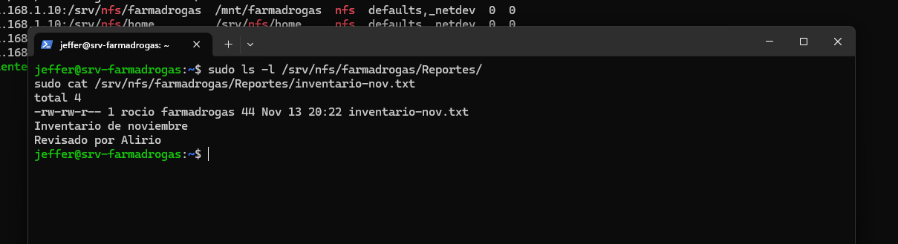

---

## 7. Verificación (Parte B)

| Requisito | Evidencia | Estado |
|---|---|---|
| NTP: clientes sincronizados con el servidor | S3B-03 (Linux) y captura 12 de la semana 2 (Windows) | ✅ |
| NIS: servicio activo | S3B-04, S3B-05 | ✅ |
| NIS: clientes se autentican con NIS | S3B-07, S3B-09, S3B-10 | ✅ |
| NFS: directorio montado en el cliente (persistente en `fstab`) | S3B-06, S3B-08 | ✅ |
| NFS: permisos correctos | S3B-09 a S3B-12 | ✅ |

## 8. Problemas encontrados y soluciones

| Problema | Causa | Solución |
|---|---|---|
| El cliente se sincronizaba con servidores NTP de internet y no con el de la droguería | Ubuntu 26.04 trae fuentes NTP predeterminadas en chrony y elige la que considera mejor | Comentar las líneas `pool`/`server` de `chrony.conf` y dejar solo `server 192.168.1.10` |
| Tras comentar las fuentes, chrony quedó sin ningún servidor (`Reference ID 00000000`) | Se desactivó la línea `sourcedir` que también cargaba `/etc/chrony/sources.d` | Agregar `server 192.168.1.10 iburst prefer` directamente al final de `chrony.conf` |
| En el cliente `/mnt/farmadrogas/Reportes` respondía *No such file or directory* | El montaje NFS del cliente no reflejaba las subcarpetas creadas en el servidor | `sudo umount /mnt/farmadrogas && sudo mount -a` para volver a montar |
| `ls /srv/nfs/farmadrogas/*` como `jeffer` en el servidor da *Permission denied* | El administrador no pertenece al grupo `farmadrogas` | Comportamiento esperado; para revisar se usa `sudo` |
